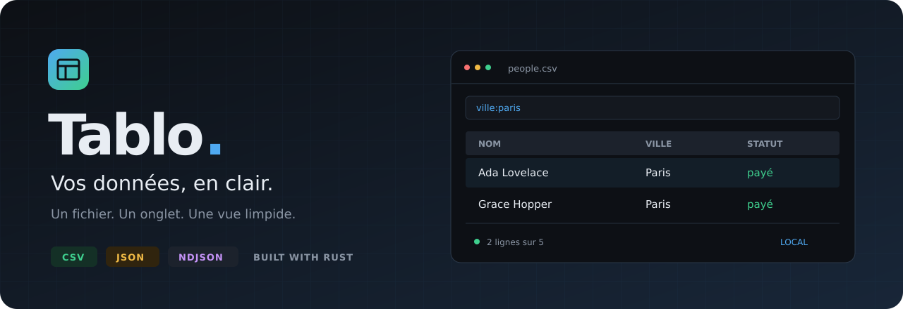

<div align="center">



**Ouvrez. Explorez. Filtrez.**

Un lecteur de fichiers CSV et JSON en Rust, dans une interface de bureau sombre et épurée.

[](https://github.com/Yusufibin/tablo/actions/workflows/ci.yml)
[](Cargo.toml)
[](Cargo.toml)
[](LICENSE)

[Installation](#installation) · [Utilisation](#utilisation) · [Recherche](#recherche) · [Contribuer](CONTRIBUTING.md)

</div>

## Pourquoi Tablo ?

Un export CSV à vérifier, un fichier JSON à parcourir, des journaux NDJSON à filtrer :
Tablo rassemble vos fichiers dans une seule fenêtre, avec un onglet par document.
Les fichiers sont lus et filtrés localement, sans compte ni service distant.

Tablo est un **lecteur et explorateur de données** avec export de la vue filtrée.
Il s’agit d’une application de bureau, à compiler et à lancer sur votre ordinateur.

## Fonctionnalités

| | Ce que vous pouvez faire |
| --- | --- |
| **Formats** | Lire CSV, TSV, JSON et NDJSON (`.ndjson`, `.jsonl`). |
| **Détection automatique** | Reconnaître les séparateurs virgule, point-virgule, tabulation et barre verticale ; lire UTF-8 et Latin-1. |
| **Exploration JSON** | Afficher des objets aplatis (`user.name`) en tableau ou parcourir une arborescence. |
| **Recherche** | Combiner termes, expressions exactes, filtres par colonne et exclusions. |
| **Tri** | Trier au clic sur un en-tête, avec comparaison numérique pour les nombres. |
| **Navigation** | Ouvrir plusieurs onglets, glisser-déposer des fichiers, inspecter une cellule et parcourir les tableaux larges. |
| **Export** | Enregistrer la vue filtrée en CSV ou JSON. |
| **Prise en main** | Ouvrir les exemples intégrés directement depuis l’accueil. |

## Installation

### Prérequis

- Une version récente de **Rust stable**, avec Cargo, installée via [rustup](https://rustup.rs/).
- Une session graphique pour afficher l’application.
- Sous Linux, les bibliothèques de développement nécessaires au moteur de fenêtre.
  Exemple pour Ubuntu / Debian :

```bash
sudo apt-get update
sudo apt-get install -y build-essential pkg-config libxkbcommon-dev libwayland-dev libgl1-mesa-dev
```

### Compiler depuis les sources

```bash
git clone https://github.com/Yusufibin/tablo.git
cd tablo
cargo run --release --locked -- samples/people.csv
```

### Installer la commande `tablo`

Depuis le dossier du projet :

```bash
cargo install --locked --path .
tablo fichier.csv
```

Assurez-vous que le répertoire des binaires Cargo (`~/.cargo/bin` par défaut) figure dans votre `PATH`.

## Utilisation

```bash
# Ouvrir l’accueil, puis choisir ou déposer un fichier
tablo

# Ouvrir plusieurs fichiers, chacun dans son onglet
tablo samples/people.csv samples/products.json samples/config.json

# Explorer des événements NDJSON
tablo samples/events.ndjson

# Lire un flux depuis l’entrée standard
cat data.csv | tablo -

# Afficher l’aide ou la version
tablo --help
tablo --version
```

Sans installation, remplacez `tablo` par `cargo run --release --locked --` dans ces commandes.

## Recherche

La recherche ignore la casse. Tous les termes doivent correspondre à la ligne,
éventuellement dans des cellules différentes.

| Exemple | Résultat |
| --- | --- |
| `ada paris` | Lignes contenant les deux termes. |
| `"New York"` | Expression recherchée dans une même cellule. |
| `ville:"New York"` | Expression dans la colonne `ville`. |
| `"Nom complet":ada` | Recherche dans une colonne dont le nom contient des espaces. |
| `-statut:inactif` | Exclut les lignes contenant `inactif` dans `statut`. |
| `ville:paris -archivé` | Combine une recherche et une exclusion. |

Pour rechercher un tiret initial littéralement, utilisez des guillemets : `"-10"`.
Dans une expression entre guillemets, `\"` représente un guillemet et `\\` une barre oblique inverse.
Le menu contextuel d’une cellule permet aussi de créer un filtre sur sa valeur.

## Raccourcis clavier

| Touche | Action |
| --- | --- |
| `Ctrl+O` | Ouvrir un fichier |
| `Ctrl+F` | Activer la recherche |
| `Ctrl+C` | Copier la cellule sélectionnée |
| `Ctrl+Shift+C` | Copier la ligne en JSON |
| `Ctrl+G` | Aller à la ligne |
| `Ctrl+S` | Exporter la vue filtrée |
| `Ctrl+W` | Fermer l’onglet actif |
| `Ctrl+Tab` / `Ctrl+Shift+Tab` | Changer d’onglet |
| `F5` / `Ctrl+R` | Recharger le fichier |
| `F1` | Afficher l’aide |
| Flèches | Déplacer la sélection |

Sur macOS, les raccourcis `Ctrl` utilisent la touche `⌘`.

## Développement

```bash
cargo fmt --all -- --check
cargo clippy --locked --all-targets -- -D warnings
cargo test --locked
```

Les tests couvrent notamment le chargement des formats, la détection des séparateurs,
le filtrage, le tri et la navigation. GitHub Actions vérifie le formatage, l’analyse
statique et les tests à chaque push sur `main` et à chaque pull request.

| Fichier | Rôle |
| --- | --- |
| [`src/main.rs`](src/main.rs) | Point d’entrée et arguments de lancement |
| [`src/app.rs`](src/app.rs) | Onglets, chargement et état de l’application |
| [`src/load.rs`](src/load.rs) | Lecture, détection des formats et conversion |
| [`src/sheet.rs`](src/sheet.rs) | Modèle tabulaire, recherche, tri et export |
| [`src/ui.rs`](src/ui.rs) | Grille, arbre JSON et interactions |
| [`src/theme.rs`](src/theme.rs) | Couleurs, typographie et style |
| [`samples/`](samples/) | Fichiers d’exemple |

Interface construite avec [egui](https://github.com/emilk/egui) et eframe.
Consultez le [guide de contribution](CONTRIBUTING.md) pour proposer une amélioration,
ou [ouvrez une issue](https://github.com/Yusufibin/tablo/issues) pour signaler un problème.

## Licence

Distribué sous [licence MIT](LICENSE). © 2026 Yusufibin.
